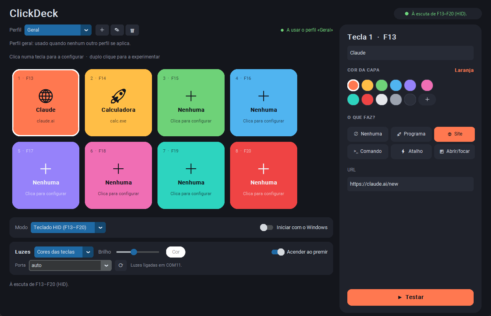

# ClickDeck

Macropad USB com 8 botões (Arduino Pro Micro) e uma app Windows para escolher o que cada botão faz, com uma barra de 8 LEDs controlada a partir do PC. Inclui o firmware, a app e os ficheiros 3D para imprimir.



## Faz o teu em 6 passos

Não precisas de saber programar. Precisas de um ferro de soldar, de uma impressora 3D e de um PC com Windows.

| # | Passo | Tempo |
|---|-------|-------|
| 1 | Compra o material (lista abaixo) | - |
| 2 | Imprime a caixa, a tampa e as capas (pasta `case/`) | 2-4 h |
| 3 | Carrega o firmware na Pro Micro ([Carregar o firmware](#carregar-o-firmware)) | 10 min |
| 4 | Solda os botões e a barra de LEDs ([Material e ligações](#material-e-ligações)) | 1 h |
| 5 | Monta na caixa: switches na tampa, Pro Micro e ligações dentro da base | 15 min |
| 6 | Instala a app ([Correr a app](#correr-a-app)) e configura as teclas | 10 min |

Faz o passo 3 antes de soldar: assim confirmas que a placa funciona e que o upload corre bem.

### Lista de compras

| Peça | Qtd | Notas |
|------|-----|-------|
| Arduino Pro Micro (ATmega32U4) | 1 | Versão 5 V / 16 MHz, com USB-C ou micro-USB. Confirma que é a ATmega32U4: um Nano ou Uno não serve (não faz de teclado USB). |
| Switches mecânicos MX | 8 | Qualquer marca; os de 3 pinos servem (usam-se só 2 contactos). |
| Capas MX | 8 | Imprimes tu (`case/keycap.stl`) ou compras. |
| Barra de 8 LEDs WS2812 | 1 | Opcional. Usei a Mateksys 2812-8slim; qualquer fita ou barra WS2812 de 5 V serve (se tiver mais de 8 LEDs, só acendem os 8 primeiros). |
| Cabo USB com dados | 1 | Cabos só de carga não funcionam. |
| Fio fino e estanho | - | Um fio GND comum para todos os switches. |
| Resistência de 330 Ω | 1 | Opcional, entre D10 e o fio de dados dos LEDs. |

Sem díodos nem resistências para os botões. O preço depende dos fornecedores; a Pro Micro e os switches são o grosso.

### Impressão 3D

- Ficheiros em `case/`: `caixa.stl` (base, 93,2 × 78,3 × 24,8 mm), `tampa.stl` (tampa, 90,0 × 73,3 × 14,8 mm) e `keycap.stl` (capa, 18 × 18 × 10 mm; imprime uma por botão).
- Base com o fundo na mesa. Placa com a face de cima para baixo. Capas de pé, camada de 0,12 a 0,16 mm.
- Confirma com um paquímetro que os switches e a Pro Micro cabem antes de imprimir tudo: imprime primeiro a tampa e experimenta um switch.
- Se os pinos da Pro Micro vierem soldados para baixo, corta-os rentes antes de montar.
- Cada capa pode ser impressa na cor que escolheres para essa tecla na app.


## Funcionalidades

- 8 botões que a Pro Micro envia como teclado USB (F13–F20); a app trata-os como atalhos globais, sem administrador.
- Cada botão pode abrir um programa ou ficheiro, um site, correr um comando, enviar um atalho de teclado, **clicar num ponto da janela** (por exemplo num botão da barra de ferramentas que não tem atalho) ou abrir/focar uma app.
- **Perfis por aplicação:** as teclas mudam sozinhas conforme a janela que está à frente (por exemplo, outras ações no Fusion 360).
- Nome e cor da capa por tecla, para coincidir com as capas impressas de várias cores.
- **Barra de LEDs WS2812** controlada pela app: cores das teclas, uma cor por LED, cor única, arco-íris, respirar, brilho e clarão ao premir.
- Ícone na bandeja, início com o Windows, uma só instância, seletor de porta COM.
- Caixa, tampa e capas para imprimir em 3D (STL).

## Estado

- Testado: arranque da app, simulação, ações, perfis, deteção da placa e envio das cores (resposta `CLICKDECK 1` na porta série).
- Por confirmar em hardware completo: botões soldados na caixa e a barra de LEDs montada. A caixa ainda não tem sítio para a barra.
- O firmware não foi compilado fora do Arduino IDE; precisa das bibliotecas Bounce2 e Adafruit NeoPixel.

## Material e ligações

- 1 × Arduino Pro Micro (ATmega32U4) e cabo USB (dados)
- 8 × switches mecânicos (MX)
- 1 × barra de 8 LEDs WS2812 (Mateksys 2812-8slim), opcional (só 2 contactos elétricos); sem resistências nem díodos

Um contacto de cada switch vai ao pino indicado e o outro a um **GND comum**. O firmware usa `INPUT_PULLUP` (premido = LOW).

| Botão | Pino | Tecla enviada |
|-------|------|---------------|
| 1 | D2 | F13 |
| 2 | D3 | F14 |
| 3 | D4 | F15 |
| 4 | D5 | F16 |
| 5 | D6 | F17 |
| 6 | D7 | F18 |
| 7 | D8 | F19 |
| 8 | D9 | F20 |

```
 Pro Micro (USB para cima)        Cada switch (2 contactos usados)

   TXO  [ ]  [ ] RAW
   RXI  [ ]  [ ] GND                 pino ──┐
   GND  [ ]  [ ] RST                        ○ ── switch ──○
   GND  [ ]  [ ] VCC                              │
    D2  [x]  [ ] A3                    GND comum ─┘
    D3  [x]  [ ] A2
    D4  [x]  [ ] A1
    D5  [x]  [ ] A0
    D6  [x]  [ ] D15
    D7  [x]  [ ] D14
    D8  [x]  [ ] D16
    D9  [x]  [ ] D10
```

Botão 1 → D2, botão 2 → D3, … botão 8 → D9. Os outros 8 terminais vão todos ao mesmo fio de GND (ligado a um dos pinos GND ao lado do D2). Sem resistências nem díodos.

Barra de LEDs WS2812 (Mateksys 2812-8slim, 8 LEDs), fios como na foto:

| Fio | Marcação na barra | Liga a |
|-----|-------------------|--------|
| preto | G | GND (qualquer pino GND da Pro Micro) |
| vermelho | 5V | RAW (os 5 V do USB) |
| azul | DIN | D10 (opcional: resistência de 330 Ω pelo meio) |
| roxo | DO | não ligar (isolar a ponta com fita) |

O LED n acompanha o botão n. O firmware limita o brilho para a barra não passar de ~250 mA (o USB dá 500 mA). A Pro Micro tem de ser de 5 V; numa de 3,3 V o sinal de dados fica no limite.

Os pinos e as teclas estão em constantes no topo de [firmware/clickdeck/clickdeck.ino](firmware/clickdeck/clickdeck.ino).

## Carregar o firmware

1. Instala o [Arduino IDE](https://www.arduino.cc/en/software).
2. Biblioteca **Bounce2**: `Sketch → Include Library → Manage Libraries…`, procura «Bounce2» (Thomas O Fredericks) e instala. Instala também **Adafruit NeoPixel** (Adafruit). A biblioteca `Keyboard` já vem com o IDE.
3. `Tools → Board`: escolhe **Arduino Leonardo** (serve para a Pro Micro de 5 V / 16 MHz). Para a versão de 3,3 V / 8 MHz instala o pacote *SparkFun AVR Boards* e escolhe *SparkFun Pro Micro* com o processador correto.
4. Liga a placa por USB e escolhe a porta em `Tools → Port`.
5. Abre `firmware/clickdeck/clickdeck.ino` e carrega em **Upload**.
6. Se o upload falhar (a Pro Micro muda de porta ao fazer reset), carrega no Upload e **faz curto-circuito RST–GND duas vezes seguidas** durante a mensagem «Uploading…».
7. Teste: abre o Bloco de Notas, carrega num botão e confirma que não aparece nada (F13–F20 não escrevem texto) — a verificação a sério é feita pela app.

## Correr a app

Requer Python 3.11+ no Windows.

```bash
cd app
pip install -r requirements.txt
python main.py
```

- A janela mostra as 8 teclas desenhadas (acendem quando carregas no botão físico). **Clica numa tecla** para a configurar no painel da direita: nome, cor e o que faz (programa/ficheiro, site, comando, atalho de teclado, clique numa posição, abrir ou focar app). **Duplo clique** numa tecla experimenta-a; o botão **Testar** faz o mesmo. Nos atalhos, o botão ⏺ grava a combinação que premires.
- As alterações são guardadas automaticamente. Fechar a janela deixa a app na bandeja (clica no ícone para reabrir, ou «Sair» no menu).
- Só corre uma instância: se abrires o ClickDeck outra vez, a janela da que já está aberta aparece (a porta da placa e as teclas F13–F20 só podem ter um dono).
- **Luzes:** o cartão «Luzes» controla a barra de LEDs (modo, brilho, cor, «acender ao premir»). No modo «Cores das teclas» cada LED mostra a cor da capa da tecla correspondente; em «Cores personalizadas» escolhes a cor de cada LED (cliques nos círculos 1–8); «Cor única» usa o botão «Cor». O seletor «Porta» (⟳ para atualizar) permite escolher a porta COM se a deteção automática não a encontrar. A app fala com a placa pela porta série USB (procura sozinha a porta da Arduino/SparkFun e confirma que é o ClickDeck); se não houver barra ou firmware com luzes, só mostra o aviso. Não funciona no modo «Série».
- **Abrir ou focar:** se o programa já estiver aberto, passa-o para a frente; se não, abre-o. Carrega em 🎯, muda para o programa nos 4 segundos seguintes e a app preenche o caminho do `.exe` e o nome dele. A procura da janela aceita parte do título ou o nome do `.exe` (por exemplo `Fusion360.exe`), que não muda com o documento aberto.
- **Clicar na janela:** em «Clicar», carrega em 🎯 e faz no programa os cliques que queres automatizar (esquerdos e direitos). A gravação acaba 2,5 s depois do último clique. A app guarda cada clique relativo ao canto da janela; se o clique foi num menu que abriu junto ao cursor (por exemplo, o menu do botão direito), guarda-o relativo ao clique anterior. Ao premir o botão físico repete a sequência e devolve o cursor ao sítio onde estava. Podes editar o texto à mão: `x,y` (clique esquerdo), `R x,y` (direito), `@dx,dy` (relativo ao clique anterior), `w300` (esperar 300 ms). Exemplo: `R 812,455; @34,88`. Funciona enquanto a janela tiver o mesmo tamanho e layout; se mudares, grava de novo.
- **Exportar e importar a configuração:** os botões «Exportar» e «Importar» (no cartão do «Modo») gravam e lêem um ficheiro `.json` com os perfis, teclas, cores e luzes, para passares tudo para outro PC. A pasta por omissão é `Documentos\ClickDeck`, fora da pasta do programa. A porta COM e o «Iniciar com o Windows» não vão no ficheiro (são de cada PC) e não mudam ao importar. Antes de importar, a app guarda uma cópia da configuração atual, e os caminhos de programas podem ter de ser ajustados no outro PC.
- **Onde fica a configuração:** em `%APPDATA%\ClickDeck\config.json`, com cópias automáticas em `backups\`. Fica fora da pasta do programa, por isso não vai para o GitHub.
- **Perfis por app:** o seletor «Perfil» (＋ novo, ✎ renomear, 🗑 apagar) permite ter teclas diferentes para cada programa. O perfil «Geral» é o de base; num perfil novo usa «Detetar» (muda para a app em 4 segundos) para dizer quando fica ativo, por exemplo `Fusion360.exe`. Uma tecla deixada vazia nesse perfil faz o mesmo que no Geral. A app muda de perfil sozinha conforme a janela que estiver à frente.
- Modo **Simulação** (no seletor «Modo»): não escuta hardware; usa o duplo clique nas teclas.
- Por omissão: botão 1 abre `https://claude.ai/new` e botão 2 abre `calc.exe`.
- A configuração fica em `%APPDATA%\ClickDeck\config.json`. «Iniciar com o Windows» escreve em `HKCU\...\Run` (sem administrador) e arranca já na bandeja.
- Modo HID: a app regista F13–F20 como hotkeys globais (`RegisterHotKey`, sem administrador). Se outra app já as usa, a barra de estado avisa quais falharam.
- Modo Série: serve para placas sem USB nativo (Uno/Nano) que enviem `D1`…`D8` / `U1`…`U8` a 9600 baud. Com a Pro Micro usa o modo HID.

## Protocolo das luzes

A app e o firmware falam por linhas de texto na porta série virtual USB (115200 baud, terminadas em `
`):

| Comando | Efeito |
|---------|--------|
| `?` | a placa responde `CLICKDECK 1` (a app usa isto para a encontrar) |
| `M0`…`M4` | modo: 0 desligado, 1 cores das teclas, 2 cor única, 3 arco-íris, 4 respirar |
| `B0`…`B255` | brilho |
| `Crrggbb` | cor única (hex) |
| `K1`…`K8` + `rrggbb` | cor do LED n |
| `R0` / `R1` | acender ao premir desligado / ligado |

## Caixa 3D e capas

Em `case/` há três ficheiros STL: `caixa.stl` (base), `tampa.stl` (tampa com as aberturas dos switches) e `keycap.stl` (capa de 18 × 18 mm). A caixa ainda não tem sítio para a barra de LEDs.

## Problemas comuns

| Sintoma | O que fazer |
|---------|-------------|
| O upload falha ou não aparece porta | Cabo só de carga? Experimenta outro. Carrega em Upload e faz curto-circuito RST–GND duas vezes seguidas. |
| Carrego num botão e nada acontece | Confirma que a app está aberta (ícone na bandeja) e que o modo é «Teclado HID». Se a barra de estado diz que não registou F13–F20, outro programa já as usa. |
| As luzes não mudam | Vê o texto no cartão «Luzes». Se diz que não consegue abrir a porta, outro programa (por exemplo o Monitor Série do Arduino IDE) está a usá-la. Escolhe a porta no seletor «Porta». |
| As luzes não respondem de todo | A placa pode ter firmware sem luzes: volta a carregar `firmware/clickdeck/clickdeck.ino` (precisa da biblioteca Adafruit NeoPixel). |
| Um botão faz de outro | Confirma o pino de cada switch na tabela de ligações. |

## Gerar um .exe

```bash
cd app
pip install pyinstaller
pyinstaller --noconsole --onefile --name ClickDeck main.py
```

O executável fica em `app/dist/ClickDeck.exe`. «Iniciar com o Windows» passa a apontar para ele.

## Licença

Código, firmware, scripts e modelos 3D sob a licença [MIT](LICENSE): podes usar, alterar e partilhar à vontade.

## Estrutura

```
firmware/clickdeck/clickdeck.ino   firmware da Pro Micro
app/main.py                 arranque e ligação dos módulos
app/clickdeck/config.py     JSON em %APPDATA%
app/clickdeck/actions.py    execução das ações
app/clickdeck/listener.py   hotkeys F13–F20 / série / simulação
app/clickdeck/gui.py        janela de configuração
app/clickdeck/tray.py       ícone da bandeja
app/clickdeck/autostart.py  iniciar com o Windows
app/clickdeck/leds.py       controlo da barra de LEDs pela porta série
app/clickdeck/foreground.py janela ativa (perfis por aplicação)
app/clickdeck/singleton.py  uma só instância
app/clickdeck/icon.py       ícone da app
case/                       caixa, tampa e capa (STL)
```
